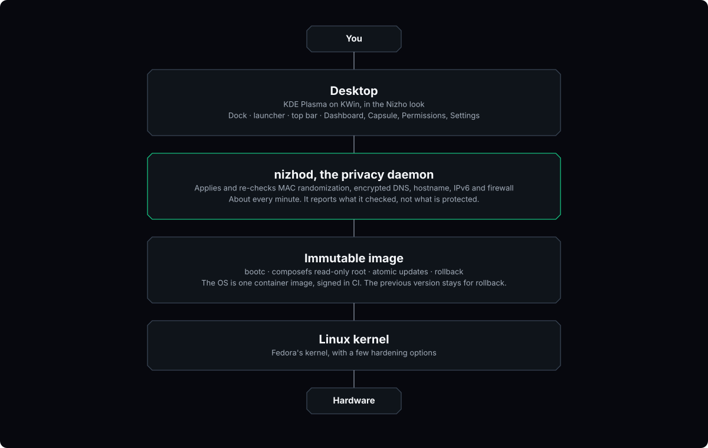
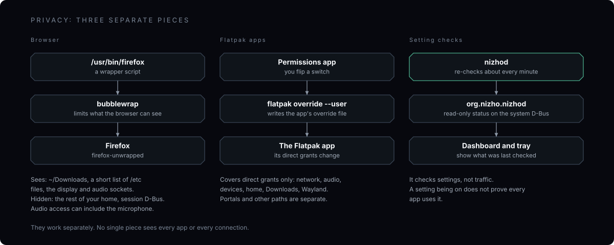
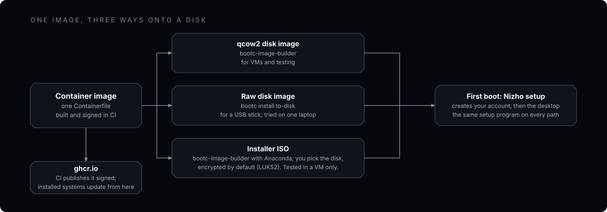
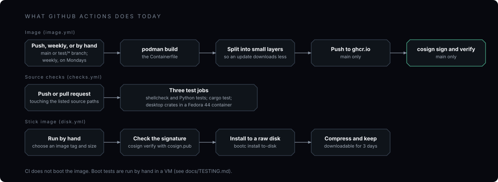
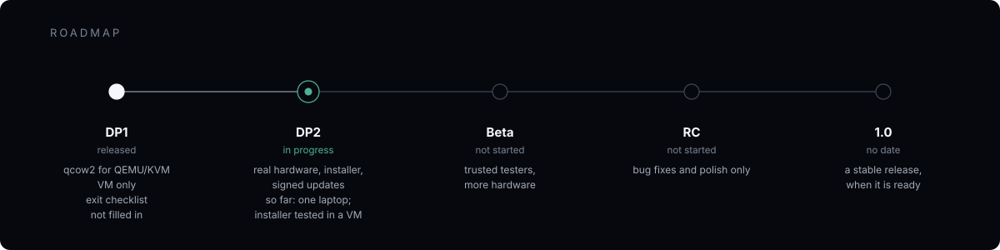

<p align="center">
  <picture>
    <source media="(prefers-color-scheme: dark)" srcset="assets/branding/nizho-wordmark-dark.svg"/>
    
  </picture>
</p>

<p align="center">A desktop Linux where privacy settings are on by default, and the system tells you plainly what it checked and what it didn't.</p>

<p align="center"><strong><a href="https://nizho-os.github.io/nizho/">Website</a></strong> · <a href="https://nizho-os.github.io/nizho/#tour">One-minute tour video</a> · <a href="https://nizho-os.github.io/nizho/docs/">Docs</a></p>

<p align="center">Version 0.1.0-dp1 · Developer Preview · GPL-3.0</p>

> **Nizho is a separate project that began as a copy of [ArkaOS](https://github.com/thulasiramk-2310/Arka).** Both were
> created by Thulasiram K ([thulasiramk-2310](https://github.com/thulasiramk-2310)); ArkaOS continues on its own and is not
> related to other software called ArKaos or to Arka Linux. Every test result in this README and in
> [docs/TEST-LOG.md](docs/TEST-LOG.md) was recorded on ArkaOS builds. The first Nizho image was built and booted on
> 2026-11-01 (splash, setup, login and desktop all came up), and has not been tested beyond that.

<p align="center">
  
</p>

---

## What is Nizho?

Nizho is a desktop Linux we are building around one idea: the privacy
settings that matter should already be on when you first log in, and the
system should say clearly what it checked.

It is not a new kernel and not a distribution from scratch. It is Fedora's
bootc image with KDE Plasma on top, a small Rust daemon called
[`nizhod`](nizhod/), a few apps of our own, and a sandboxed Firefox.

The OS ships as one image. The root filesystem is read-only while the system
runs. An update swaps in a whole new image, and the previous one stays so you
can go back. `nizhod` applies a handful of privacy settings and checks them
again about once a minute. When it says a setting is *Configured*, that
setting is in place. It does not mean your apps or your network traffic are
private.

> **Read this first.** Nizho is a developer preview. Don't rely on it to
> protect anything important yet. It has booted on one real laptop, the
> installer has only been tested in a VM, and nothing here is a security
> guarantee. See the [threat model](docs/THREAT-MODEL.md) and
> [SECURITY.md](SECURITY.md).

## Developer Preview 1

DP1 is the first thing we released: a qcow2 disk image for QEMU/KVM, for
developers, with no installer. Everything below was tested in a VM. The last
column says where else we have seen it work.

We released it, but its exit checklist
([docs/DP1-EXIT-CRITERIA.md](docs/DP1-EXIT-CRITERIA.md)) was never filled in.
So we can't show that every item on it was met.

| Part | What it is | Seen working |
|---|---|---|
| Read-only root (composefs) | The system files can't be changed while it runs | VM |
| Image updates | The whole image is swapped, the old one is kept | VM |
| `nizhod` | Daemon that applies and re-checks privacy settings | VM |
| Privacy Dashboard | Lists each setting and when it was last checked | VM |
| Browser sandbox | Firefox runs inside bubblewrap | VM |
| Permissions app | Switches for the direct grants of Flatpak apps | VM |
| Capsule | App store front end for Flathub | VM |
| KDE Plasma look | Nizho theme, icons, cursor, sounds, wallpaper | VM, one laptop |
| Boot animation and login screen | Plymouth and SDDM themes | VM |
| First-boot setup | Creates your account | VM |
| Wi-Fi, Bluetooth, power profiles | KDE's own tools | Included in the image; Wi-Fi seen on one laptop |
| Search, clipboard, file previews | KDE's own tools | VM |

Details: [Release Notes](docs/RELEASE-NOTES-DP1.md) · [Changelog](CHANGELOG.md)

## Since DP1: work toward DP2

The work since DP1 is grouped below. Almost all of it has been tested in a virtual machine only, and each feature
says exactly what was and was not tested. The full list is in [docs/FEATURES.md](docs/FEATURES.md).

- **Real hardware:** a first USB boot on one laptop, and what it found.
- **Installing, updating, rolling back:** an installer ISO with disk encryption, signed updates, automatic rollback.
- **Privacy and security:** setting checks, the browser sandbox, app permissions, the firewall.
- **Desktop:** the Nizho look, dock, launcher, top bar, spaces, shortcuts ([list](docs/SHORTCUTS.md)), Light and Dark, green or blue.
- **Working with files:** the format wheel, the edit wheel, make smaller, ZIP, hide private details.
- **For developers:** VARA and Git in setup.

Still a developer preview: the installer is new and VM-tested only, we have one
hardware data point, and the known rough edges are in the release validation notes and the field notes.

### Known gaps

What a daily-use desktop needs that Nizho does not do yet, or that nobody has tested:

- **Video and audio formats:** only Fedora's free codecs are installed, so some files (for example H.265 video or AAC audio) may not play. Not tested; VLC from Install Apps may cover it.
- **NVIDIA graphics cards:** there is no proprietary NVIDIA driver, so those cards use the open driver. Not tested.
- **Backing up your files:** rollback protects the system, not your documents. There is no backup tool yet.
- **Language and keyboard:** setup now asks for both. It has unit tests and a preview render, but has not yet been run in a booted image. How much of the desktop is translated depends on the language.
- **Never tried:** printing, scanning, webcam, suspend and hibernate, several monitors, Bluetooth pairing, and any hardware beyond the one laptop.

VPN is not a gap: OpenVPN is installed and NetworkManager has WireGuard built in, though neither has been tested here.

---

## Architecture

The top diagram shows the layers. The detailed map of how the pieces talk to each other is at the top of
[docs/ARCHITECTURE.md](docs/ARCHITECTURE.md), together with why bootc, why Plasma, why D-Bus, and why we
don't write our own compositor.

## The privacy model

<p align="center">
  
</p>

There is no single gatekeeper. These are three separate pieces.

**The browser has a restricted view of the filesystem.** The wrapper hides your
real home, except `~/Downloads`, which the browser can read and write. It
exposes a short list of system files plus the Wayland and audio sockets. Audio
access can include microphone recording. The session D-Bus is hidden. Our
earlier isolation checks are in [PHASE4-SANDBOX.md](docs/PHASE4-SANDBOX.md). Each
release still needs to be tested again.

**The Permissions app edits Flatpak settings.** It changes the direct grants of
installed Flatpak apps (network, audio, devices, home, Downloads, Wayland).
Portals and other access paths are separate, so a switch here is not a complete
picture of what an app can reach.

**`nizhod` checks settings.** It tries to apply MAC randomization, strict
DNS-over-TLS, a generic hostname, IPv6 temporary addresses and the Nizho
firewall zone, then checks them again about every minute. A per-network DNS
exception is shown as an exception, never as encrypted. Checks can fail, and a
configured DNS policy does not prove that every app uses it. The tray counts a
check as current only if it finished less than three 30-second polls ago.

OS rollback picks another system image. It does not restore older personal
files, and it can't promise the older image will boot.

## One image, three ways onto a disk

<p align="center">
  
</p>

All three start from the same container image, and all three end in the same
first-boot setup. The ISO's installer also edits `/etc/fstab` and points the
system at the published image, so the installed systems are not byte-for-byte
the same. The qcow2 and raw images come out of different tools, and only the
qcow2 is the DP1 release. The strategy doc is partly out of date. See
[docs/INSTALLATION-ARCHITECTURE.md](docs/INSTALLATION-ARCHITECTURE.md).

## How it's built

<p align="center">
  
</p>

GitHub Actions builds and signs the image and runs the source tests. It does
not boot the image. We do that by hand in a VM. Our rule is that nothing counts
as done until we have watched it work in a booted VM, because **a build that
compiles is not a build that works**. For security claims we also check the
exact deployed file, path and user. `scripts/qa-boot-loop.sh` boots an image
many times and records failures. Our target was 100 of 100 clean boots before
DP1. [docs/DP1-EXIT-CRITERIA.md](docs/DP1-EXIT-CRITERIA.md) lists it as not
checked off, and we have no recorded run of it, so we can't say it was met. See
also [docs/TESTING.md](docs/TESTING.md).
To build it yourself, see [docs/BUILDING.md](docs/BUILDING.md).

## Screenshots

There are none yet. The screenshots we had were taken on ArkaOS builds and show the old name and logo. They will be
retaken from the first Nizho image, after it is built and tested.

## Roadmap

<p align="center">
  
</p>

We don't have dates for Beta, RC or 1.0. DP2's final scope is not fixed yet;
it depends on what we learn from daily use ([DP2 notes](docs/DP2.md)).

## Repository

```
Containerfile                      the OS: everything in the image is declared here
cosign.pub                         the key installed systems check updates against

nizhod/                            privacy daemon (Rust, static musl)
nizho-pulse/                       read-only System Health service
nizho-shell/                       GTK4 first-party apps, shared design tokens and IPC types
convert/                           Convert to, edit and format wheel tools
apps/                              the app list and the nizho install command

desktop/                           the Nizho look and the desktop around KWin
  desktop/plasma-launcher/         launcher panel
  desktop/plasma-style/            popups and panel style
  desktop/panels/                  top bar on every screen
  desktop/crystal-dock/            dock patch and build
  desktop/nizho-icons/             icon theme
  desktop/plymouth-theme-nizho/    boot splash
  desktop/sddm-theme-nizho/        login theme
  desktop/desktop-files/           launcher entries
  desktop/nizho-design-system/     design spec: tokens, motion, components

system/                            what runs on the installed machine
  system/nizho-firstboot           first-boot setup
  system/nizho-oobe-apply          creates the account and applies your choices
  system/nizho-plasma-firstrun     first-login branding one-shot
  system/nizho-apply-look          Light/Dark and green/blue switch
  system/nizho-firefox             sandbox wrapper
  system/systemd/                  update-status publisher for unprivileged apps
  system/firewalld/                the Nizho firewall zone
  system/kernel/                   kernel hardening (boot options and runtime settings)
  system/installer/                installer ISO and disk image configuration

docs/                              architecture, building, testing, installation, release notes
scripts/                           QA harnesses, make-disk.sh, make-iso.sh, flash-usb.sh
assets/                            README diagrams
website/                           the project site
```

Research that is not part of the image lives in its own repositories:
[nizho-agent](https://github.com/nizho-os/nizho-agent), an on-device assistant that asks for your approval before it
does anything, and [nizho-wm](https://github.com/nizho-os/nizho-wm), a compositor prototype.

## Documentation

| | |
|---|---|
| [Architecture](docs/ARCHITECTURE.md) | why each piece exists and how they talk |
| [Building](docs/BUILDING.md) | source to image to VM |
| [Testing](docs/TESTING.md) | how we verify, the QA scripts, budgets |
| [Installation](docs/INSTALLATION-ARCHITECTURE.md) | VM image, USB image and installer ISO (partly out of date) |
| [Threat model](docs/THREAT-MODEL.md) | what Nizho does and does not protect against |
| [Design System](desktop/nizho-design-system/README.md) | tokens, typography, motion, components |
| [Release Notes](docs/RELEASE-NOTES-DP1.md) | what DP1 has, what is known to be incomplete |

## Security

Report problems privately through the repository's Security tab (*Report a
vulnerability*). We count wording that claims more protection than the system
gives as a bug too. Details are in [SECURITY.md](SECURITY.md).

---

<p align="center">
  <strong>Nizho</strong> · <a href="https://github.com/thulasiramk-2310">Thulasiram K</a> · GPL-3.0
</p>
